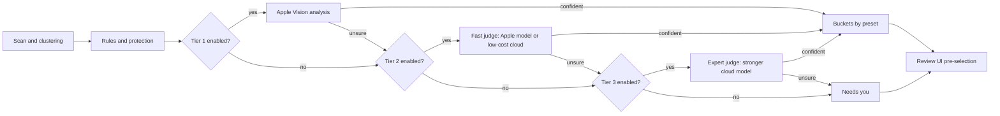
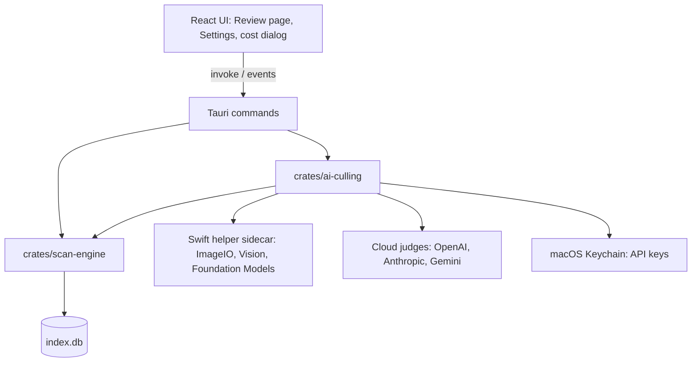

# AI-assisted keeper selection: research and plan

Status: proposal, not implemented. Prices and model names were checked on 2026-11-03 and will change; the design keeps them in editable settings for that reason.

Related: [MCP and skills (deferred draft)](ai-mcp-and-skills.md).

## 1. TL;DR

- **AI can speed up culling a lot, but it should pre-select, never delete.** Vision models and Apple's on-device analysis are good at catching technical rejects: missed focus, soft subject, motion blur, closed eyes, blown highlights, accidental frames. They are not reliable at choosing between two *good* photos that differ in artistic intent. Even specialist models fine-tuned for professional photo comparison matched expert picks only 67–72% of the time on the NTIRE 2026 benchmark.
- **The key move is to recognize intent rather than judge it.** "Building sharp, friend blurred" vs "friend sharp, building blurred", or "tight portrait" vs "same pose, wider, with background", are intentional variants. Cheap signals detect most of them (changed focal length, aperture or orientation; different focus point; different sharp region). Variant groups are kept by default, so the AI never has to make the artistic call.
- **Three presets** (Conservative, Balanced, Aggressive) map AI findings into **three buckets**: *Ready to confirm* (keepers pre-selected), *Needs you* (ambiguous), *Variants, kept*.
- **Tiers you can switch on and off independently:** rules and protection (always on), Tier 1 on-device Apple analysis (free), Tier 2 fast judge (Apple on-device model, free, or a low-cost cloud model), Tier 3 expert judge (stronger cloud model). Each enabled tier only sees what earlier tiers were unsure about.
- **Nothing to install.** Local means only what ships with macOS (Vision framework, Apple Foundation Models). Cloud means pasting an API key.
- **Cost:** a 100 GB, ~10,000-photo trip with about 1,300 duplicate groups costs about **$0.09** with on-device analysis plus `gpt-6-luna` in batch mode, about **$0.85** with an expert tier added, and **$0** fully on-device. Every combination gets a cost estimate before it runs, computed from an editable price catalog, with a hard budget cap.
- **Cache keyed on file content (BLAKE3), not group IDs**, so rescans and moved folders don't call any model again.

## 2. Baseline: how the app decides today

| Area | Current behavior | Where |
| --- | --- | --- |
| Grouping | Exact copies (BLAKE3), visual (pHash, Hamming distance ≤ 6, only when file size or pixel dimensions match), burst (EXIF `DateTimeOriginal` within 2–3 s, same camera) | `cluster_duplicates` in `crates/scan-engine/src/cluster.rs` |
| Group confidence | Exact 1.0; visual `1 − min_distance / threshold`; burst fixed 0.75 | `cluster.rs` |
| Keeper suggestion | Highest pixel area wins, then earliest capture date | `suggestKeeper` in `src/pages/ReviewPage.tsx` (the test in `src/lib/suggestKeeper.test.ts` tests a copy, not the real function) |
| Metadata | Make, model, ISO, aperture, shutter, focal length, date. No lens, orientation, exposure compensation, focus point, or XMP rating. Read only when burst detection is on | `crates/scan-engine/src/exif.rs` |
| Previews | 256 px WebP thumbnails via the `image` crate | `crates/scan-engine/src/thumbnail.rs` |
| Group identity | All groups are deleted and recreated on every scan, so group IDs are not stable | `clear_groups_for_session` in `crates/scan-engine/src/db/repository.rs`, called from `run_scan` |
| Review semantics | Selected photos are *keepers*; `⌘S` trashes the rest via `keep_selected_and_trash`; selection resets to empty when the group changes; `⌘Z` restores keeper flags only (trashed files stay in macOS Trash) | `ReviewPage.tsx`, `repository.rs` |

Two findings matter for this feature:

- **HEIC is probably dropped today.** The `image` crate is built with `jpeg, png, gif, webp, tiff` and has no HEIC decoder. Under the default preset `process_file` calls `perceptual_hashes`, which fails for HEIC, and the batch silently skips the file. Confirm with a sample iPhone photo. The Swift helper proposed below decodes HEIC and RAW through Apple's ImageIO, which fixes both previews and analysis.
- **Visual grouping requires matching size or dimensions** (`size_dimension_compatible`), so most intentional variants will arrive as *burst* groups (same camera, within seconds) rather than visual groups. Union-find can also chain several intents into one group, so the judge must be allowed to split a group into sub-groups.

## 3. What kind of group is it, and should AI decide?

| Group type | Example | Who decides | Default action |
| --- | --- | --- | --- |
| Exact copy | Same file imported twice | Rules | Keep one by path policy |
| Re-export | JPEG export of a RAW-backed original, or a resized copy | Rules | Keep the original or higher resolution; keep both if one is an edited version |
| Near-identical frames | 5 burst frames, same framing and settings | AI | Pre-select the best when the others have clear technical flaws |
| Intentional variants | Your two examples below | AI *detects*, does not choose | Keep all |
| Mixed | A burst containing a tight and a wide sub-series | AI splits into sub-groups | Best per sub-group; never drop a sub-group's only photo |

Worked through with your examples:

- **"I focused on the building while my friend walks in, out of focus" vs "I focused on her, background soft."** The focus point differs (camera metadata, see below) and Tier 1 measures *which region is sharp*: subject mask sharp and background soft in one frame, the reverse in the other. Different focus targets mean **intentional variants**, so both are kept.
- **"Portrait with settings for her, then the same pose with less zoom to include the background."** Focal length changes (for example 85 mm to 35 mm) and often aperture too. A focal-length ratio above about 1.15 or an aperture change of at least one stop means **intentional variants**, so both are kept.
- **"Five frames of the same pose, one with eyes closed, one slightly soft."** Same settings, same framing, milliseconds apart: **near-identical**. Discarding the eyes-closed and soft frames is a technical call AI handles well.

Signals for intent, cheapest first:

1. **Settings deltas** from EXIF: focal length, aperture, orientation, lens, exposure compensation.
2. **Focus point** from camera metadata. iPhones write EXIF `SubjectArea`; Canon and Nikon maker notes carry AF areas; Sony writes `FocusLocation`. Read them via Apple ImageIO where exposed, with targeted Rust maker-note parsing for the rest. Nothing like `exiftool` has to be installed.
3. **Sharp region vs subject region**: tile-wise sharpness compared against Apple Vision person segmentation, face boxes and saliency.
4. **Framing similarity**: Apple Vision image feature prints. Very close means the same framing; moderately close means the same scene re-framed.

## 4. Presets and buckets

Each preset is a set of thresholds over the combined group confidence (section 5.5). The values below are starting points to tune later against example groups; they are editable under Advanced settings.

| Rule | Conservative | Balanced (default) | Aggressive |
| --- | --- | --- | --- |
| Exact copies | Pre-select one keeper | Pre-select one keeper | Pre-select one keeper |
| Clear technical rejects (soft subject, motion blur, eyes closed) | Confidence ≥ 0.95 and at least two independent signals agree | Confidence ≥ 0.85 | Confidence ≥ 0.70 |
| Best of near-identical frames when all are acceptable | Never; goes to *Needs you* | Confidence ≥ 0.90 | Confidence ≥ 0.75 |
| Intentional variants | Keep all | Keep all | Keep the best of each sub-group's near-identical frames; never drop a sub-group |
| Protected photos | Never pre-selected for deletion | Never | Never |

Buckets:

- **Ready to confirm**: every photo the AI would discard meets the preset threshold. Keepers are pre-selected; you check and press `⌘S`.
- **Needs you**: anything below threshold, any disagreement between tiers or between shuffled orders, groups beyond the budget cap, and groups no enabled tier analyzed. The AI's leaning is shown as a hint but nothing is pre-selected.
- **Variants, kept**: the group is intentional variants; all photos are pre-selected as keepers.

Protection rules (always on, override every preset):

- XMP rating ≥ 1, color label or pick flag (embedded XMP or `.xmp` sidecar).
- Edited files: an `.xmp` sidecar with edit history, or edit-style suffixes such as `-Edit`.
- RAW-backed copies when the other copies have no RAW companion (`companion_raw_path`).
- Optional folder-name list (for example "Selects", "Picks"), editable.

## 5. Tiers and routing

### 5.1 Routing



Routing rule: each enabled tier receives only the groups the earlier enabled tiers were unsure about. A disabled tier is skipped. Whatever the last enabled tier is unsure about lands in *Needs you*. Already-cached verdicts are reused and never re-sent.

### 5.2 Rules and protection (always on, free)

Exact copies and re-exports are resolved here. The default path policy prefers, in order: the copy with a RAW companion, the original format over an export, the higher resolution, the older file, the shorter path. Protection flags are attached to each photo and carried through all tiers.

### 5.3 Tier 1: on-device analysis (Apple Vision, free)

Per photo, on a 2–4 MP decode via ImageIO, plus 1:1 crops for sharpness:

- Subject location: face rectangles and landmarks, person segmentation, attention saliency, camera focus point.
- Sharpness on the subject region vs the background, motion-blur estimate, highlight and shadow clipping, noise.
- Faces: `DetectFaceCaptureQualityRequest` score per face; eyes closed derived from landmark eye openness.
- Aesthetics: `CalculateImageAestheticsScoresRequest` `overallScore` (−1 to 1) and `isUtility` (macOS 15+).
- Framing: `GenerateImageFeaturePrintRequest` embeddings.

Tier 1 resolves a group on its own when it is clearly intentional variants (*Variants, kept*), or when it is near-identical and every frame but the best has hard flags with a large margin. It also produces the subject crops and the metadata JSON the judges receive.

### 5.4 Tier 2 (fast judge) and Tier 3 (expert judge)

Same request shape; Tier 3 uses a stronger model and larger previews.

- **Input**: the group's photos as labeled previews (A, B, C…) in random order; one 1:1 subject crop per photo (sharpness is judged only from crops, because downscaled previews hide focus errors); a compact metadata JSON (settings deltas, Tier 1 metrics and flags if Tier 1 ran, Tier 2 findings for Tier 3); the versioned rubric (appendix A).
- **Output**: strict JSON (appendix B): group type, sub-groups, per-photo keep/discard/unsure, score, flags, a short reason.
- **Order-swap re-check** (per-tier toggle): close calls are re-asked with the order reversed. If the answers disagree, the group is *unsure*. Judge models are known to favor early positions. In one 2026 audit a 4B judge picked the first image 49% of the time (chance 28%) and changed its pick on 60% of prompts when reordered; an 8B judge had little slot bias but still changed its pick on 43%.
- **Large groups** (long bursts): Tier 1 drops hard-flagged frames first; anything still larger than about 6 photos is judged as a small tournament (chunks of 6, top 2 advance).
- **Reasoning off**: all three cloud vendors default to some reasoning effort, billed as output tokens. Set it to none or minimal.
- **Provider without Tier 1**: when Tier 1 is off, crops come from the camera focus point when available; otherwise only previews are sent.

### 5.5 Confidence

Confidence is computed, not asked for; model self-reported confidence is poorly calibrated and is ignored. Starting formula, to be tuned against example groups later:

```text
margin      = score(best keeper) − score(best discarded), normalized to 0..1
swapAgrees  = 1.0 if the order-swap re-check agrees or was not needed, else 0
tiersAgree  = 1.0 if Tier 1 flags and the judge agree, 0.8 if one is silent, 0.5 if they conflict
confidence  = margin × swapAgrees × tiersAgree
```

There is no per-user learning or calibration in this design; that keeps the moving parts small. Tuning happens offline with an example set (roadmap phase 4).

### 5.6 Valid tier combinations

| Enabled | What happens | Cost (section 7) |
| --- | --- | --- |
| None (rules only) | Exact copies plus today's heuristic suggestion | $0 |
| Tier 1 | Clear cases resolved on-device; the rest go to *Needs you* | $0 |
| Tier 1 + Tier 2 (Apple model) | Fully on-device | $0 |
| Tier 1 + Tier 2 (cloud) | Recommended default when a key is present | cents |
| Tier 1 + Tier 2 + Tier 3 | Hardest groups escalate | under $1 for the example trip |
| Tier 1 + Tier 3 | Skip the cheap judge | about $1.43 with `gemini-3.8-flash` |
| Tier 2 only / Tier 3 only | The judge sees every group; no on-device hints | highest |
| Tier 2 + Tier 3 | Escalation without on-device analysis | between the two |

Out-of-the-box defaults: Balanced preset; Tier 1 on (macOS 15+); Tier 2 on with the Apple model when available, otherwise off until a key is added; Tier 3 off; batch mode on; budget cap $1.00 per run.

## 6. Model landscape and prices (checked 2026-11-03)

### 6.1 Built into macOS (no install, free)

| Option | Requirements | Use | Notes |
| --- | --- | --- | --- |
| Vision framework | macOS 15+ for the aesthetics request; other requests exist on older macOS via the `VN`-prefixed API | Tier 1 | Fast, designed for real-time use; precise localization, sharpness inputs, face quality |
| Foundation Models, on-device, with image `Attachment` | macOS 27+, Apple Intelligence enabled (Apple silicon) | Tier 2 provider | Free and private. Context window is about 4,096 tokens (read `contextSize` at runtime), per-image token cost and speed are undocumented, the model is updated with the OS (no version pinning). Good at describing a crop, bad at localizing; pair it with Vision |
| Private Cloud Compute model | macOS 27 | Possible future option | Supports image input per Apple's docs, but developer access, quotas and limits for third-party apps are unclear; open question |

The app should feature-detect each option and grey out what the Mac doesn't support. The README currently targets macOS 12+.

### 6.2 Cloud models (API key)

Prices are USD per million tokens. Batch is asynchronous (minutes to hours, up to 24 h) at half price; OpenAI and Gemini also offer Flex at batch prices over normal calls.

| Tier fit | Model | Input | Output | Cached input | Batch in / out | Image tokens |
| --- | --- | --- | --- | --- | --- | --- |
| Fast | `gpt-6-luna` (OpenAI) | $0.10 | $0.50 | $0.01 | $0.05 / $0.25 | 32 px patches × 1.2 (assumed; not yet in OpenAI's sizing table) |
| Fast | `claude-haiku-5-5` (Anthropic) | $0.10 | $0.50 | $0.01 | $0.05 / $0.25 | 28 px patches × 1.0; prices for prompts ≤ 100k tokens |
| Fast | `gemini-3.1-flash-lite` (Google) | $0.25 | $1.50 | $0.025 | $0.125 / $0.75 | Fixed: 280 (low), 560 (medium), 1,120 (high) |
| Fast | `gemini-3.5-flash-lite` (Google) | $0.30 | $2.50 | $0.03 | $0.15 / $1.25 | Fixed, as above |
| Fast (fallback) | `gpt-5.6-luna` (OpenAI) | $0.20 | $1.20 | $0.02 | $0.10 / $0.60 | 32 px patches × 1.2 (documented) |
| Expert | `gemini-3.8-flash` (Google) | $0.75 → $1.50 from 2027-01-01 | $3.75 → $7.50 | $0.075 | $0.375 / $1.875 → $0.75 / $3.75 | Fixed, as above |
| Expert | `claude-sonnet-5-5` (Anthropic) | $2.00 | $10.00 | $0.10 | $1.00 / $5.00 | 28 px patches × 1.0 |
| Expert | `gpt-5.6-terra` (OpenAI) | $2.00 | $12.00 | $0.20 | $1.00 / $6.00 | 32 px patches × 1.2 |

Image token formulas:

- **OpenAI (patch-based models):** `ceil(w/32) × ceil(h/32) × multiplier`, after the model's resize limits (`detail: "low"` fits within 512×512; `"high"` within 2048 px and 2,500 patches). Check: 1024×1024 at 1.2× gives 1,229 tokens, matching OpenAI's example.
- **Anthropic:** `ceil(w/28) × ceil(h/28)`. Claude 4.7 and later downscale above 2,576 px long edge or 4,784 tokens. Check: 1000×1000 gives 1,296 tokens, matching Anthropic's table.
- **Gemini 3.x:** fixed per image by `media_resolution`: low 280, medium 560, high 1,120.

| Image | OpenAI (×1.2) | Anthropic | Gemini |
| --- | --- | --- | --- |
| 512×341 preview (3:2) | 212 | 247 | 280 (low) |
| 384×384 subject crop | 173 | 196 | 280 (low) |
| 1024×683 preview (Tier 3) | 845 | 925 | 560 (medium) |

Caveats:

- `gemini-2.5-flash-lite` ($0.10 / $0.40) is cheaper but restricted to existing users on the Gemini API and was retired on Vertex AI on 2026-10-20. Don't build on it.
- The **Gemini free tier and the invite-only Contributor tier use your content to improve Google's products.** Only use paid keys for personal or client photos.
- `gemini-3.8-flash` prices are promotional through 2026-12-31 and double on 2027-01-01. This is exactly why prices live in settings.
- Flagships (`gpt-6.1-sol`, `claude-opus-5-5`, `gemini-4-argon`) cost roughly 10–40× the fast tier. Nothing suggests they help with a perceptual task like this; users can add them to the catalog if they want.
- Default reasoning effort is on for `gpt-6-luna` (medium), `claude-haiku-5-5` (medium) and Gemini 3.x. Turn it off or set it to minimal.

## 7. Cost model

### 7.1 How many photos is 100 GB?

| Shooting format | Typical size per shot | Shots in 100 GB |
| --- | --- | --- |
| RAW + JPEG, 24 MP | ~25 MB + ~10 MB | ~2,900 |
| RAW + JPEG, 45 MP | ~50 MB + ~20 MB | ~1,400 |
| JPEG only, 24 MP | ~10 MB | ~10,000 |
| iPhone HEIC | ~3 MB | ~33,000 |

Planning figure: **10,000 photos**, about 40% in duplicate groups (about 4,000 photos), average group size 3, so about **1,300 groups** after rules.

### 7.2 Per-group request

| Part | Tier 2 | Tier 3 |
| --- | --- | --- |
| Previews | 3 × 512 px long edge (Gemini: low) | 3 × 1024 px long edge (Gemini: medium) |
| Subject crops, 1:1 pixels | 3 × 384×384 (Gemini: low) | 3 × 384×384 (Gemini: medium) |
| Metadata JSON | ~150 tokens | ~200 tokens (includes Tier 2 findings) |
| Rubric and schema | ~800 tokens | ~800 tokens |
| Output, reasoning off | ~150 tokens | ~300 tokens |

The rubric is counted as uncached. Providers only cache prefixes above a minimum length, so caching can lower these numbers slightly but never raise them.

| Model (batch) | Input tokens per group | Cost per group | Per 1,000 groups |
| --- | --- | --- | --- |
| `gpt-6-luna` | 2,105 | $0.000143 | $0.14 |
| `claude-haiku-5-5` | 2,279 | $0.000151 | $0.15 |
| `gemini-3.1-flash-lite` | 2,630 | $0.000441 | $0.44 |
| `gemini-3.5-flash-lite` | 2,630 | $0.000582 | $0.58 |
| `gemini-3.8-flash` (2026 price) | 4,360 | $0.00220 | $2.20 |
| `gemini-3.8-flash` (2027 price) | 4,360 | $0.00440 | $4.40 |
| `claude-sonnet-5-5` | 4,363 | $0.00586 | $5.86 |
| `gpt-5.6-terra` | 4,054 | $0.00585 | $5.85 |

Immediate (non-batch) mode doubles these.

### 7.3 Scenarios for the example trip

Assumptions (editable): 1,300 groups after rules; Tier 1 resolves 50%; Tier 2 escalates 20% of what it sees; batch mode; order-swap re-check off.

| Enabled tiers | Groups per paid tier | Estimated cost |
| --- | --- | --- |
| Tier 1 only, or Tier 1 + Tier 2 (Apple model) | none | $0 |
| Tier 1 + Tier 2 `gpt-6-luna` | 650 | $0.09 |
| Tier 1 + Tier 2 `claude-haiku-5-5` | 650 | $0.10 |
| Tier 1 + Tier 2 `gemini-3.1-flash-lite` | 650 | $0.29 |
| Tier 2 only `gpt-6-luna` | 1,300 | $0.19 |
| Tier 1 + Tier 2 `gpt-6-luna` + Tier 3 `gemini-3.8-flash` | 650 + 130 | $0.38 |
| Tier 1 + Tier 2 (Apple model) + Tier 3 `claude-sonnet-5-5` | 130 | $0.76 |
| Tier 1 + Tier 2 `gpt-6-luna` + Tier 3 `claude-sonnet-5-5` | 650 + 130 | $0.85 |
| Tier 1 + Tier 3 `gemini-3.8-flash` | 650 | $1.43 |
| Tier 3 only `gemini-3.8-flash` | 1,300 | $2.86 (2027 price: $5.71) |
| Tier 3 only `claude-sonnet-5-5` or `gpt-5.6-terra` | 1,300 | $7.61–7.62 |

Sensitivities:

- **Order-swap re-check** on the default 30% of close calls adds 30% to that tier.
- **Reasoning left on** (about +800 output tokens per group) adds $0.26 per 1,300 groups on `gpt-6-luna` batch and $0.78 on `gemini-3.1-flash-lite` batch.
- **Phone-heavy trip** (33,000 photos, about 4,400 groups): Tier 1 + Tier 2 `gpt-6-luna` is about $0.31.
- **Rescans** cost $0 for unchanged groups (section 8).

Upload volume: about 210 KB of small JPEG previews and crops per Tier 2 group, so about 140 MB for 650 groups (about a third more on the wire as base64). Originals are never uploaded.

### 7.4 Estimator (settings-driven)

Everything the estimate uses lives in settings, so a price change or a new model is a settings edit, not a release.

```text
G        = groups without a cached verdict for the configured tiers
reach[t] = G for the first enabled tier;
           reach[previous enabled tier] × passThrough[previous tier] for later ones
cost[t]  = reach[t] × perGroupCost[t] × (1 + recheckShare[t] if recheck[t])
perGroupCost[t] = (inputTokens × inputPrice + outputTokens × outputPrice) / 1e6
                  × (1 − batchDiscount if batch[t])
inputTokens = avgGroupSize × (imageTokens(preview) + imageTokens(crop) if crops[t])
              + metadataTokens[t] + rubricTokens
imageTokens = ceil(w / patch) × ceil(h / patch) × multiplier      (patch rule)
            | tokensPerImage[mediaResolution]                      (fixed rule)
total    = Σ cost[t] over enabled tiers
```

- **Before a run**: a dialog shows per-tier groups and cost, the total, cached groups skipped, and the budget cap. Apple tiers show $0 and a time estimate once one run has been measured.
- **During a run**: requests are submitted in chunks; when the estimate plus actual spend would exceed the cap, the run stops and the remaining groups go to *Needs you*.
- **After a run**: actual tokens and cost come from each API's reported usage and are shown next to the estimate, so you can see when the assumptions need adjusting.

Settings sketch (`ai-settings.json` in the app data directory; defaults ship with the app; API keys are not stored here):

```json
{
  "preset": "balanced",
  "budgetCapUsd": 1.0,
  "onDeviceOnly": false,
  "tiers": {
    "tier1": { "enabled": true },
    "tier2": {
      "enabled": true,
      "model": "openai/gpt-6-luna",
      "previewLongEdge": 512,
      "subjectCrops": true,
      "orderSwapRecheck": true,
      "mode": "batch"
    },
    "tier3": {
      "enabled": false,
      "model": "anthropic/claude-sonnet-5-5",
      "previewLongEdge": 1024,
      "subjectCrops": true,
      "orderSwapRecheck": false,
      "mode": "batch"
    }
  },
  "estimator": {
    "tier1PassThrough": 0.5,
    "tier2PassThrough": 0.2,
    "recheckShare": 0.3,
    "rubricTokens": 800,
    "metadataTokens": { "tier2": 150, "tier3": 200 },
    "outputTokens": { "tier2": 150, "tier3": 300 }
  },
  "presetThresholds": {
    "conservative": { "technicalReject": 0.95, "bestOfNearIdentical": null },
    "balanced": { "technicalReject": 0.85, "bestOfNearIdentical": 0.9 },
    "aggressive": { "technicalReject": 0.7, "bestOfNearIdentical": 0.75 }
  },
  "priceCatalog": [
    {
      "id": "openai/gpt-6-luna",
      "provider": "openai",
      "model": "gpt-6-luna",
      "inputPerM": 0.1,
      "outputPerM": 0.5,
      "cachedInputPerM": 0.01,
      "batchDiscount": 0.5,
      "imageTokens": { "rule": "patch", "patchPx": 32, "multiplier": 1.2, "maxLongEdge": 2048, "maxPatches": 2500 },
      "reasoning": "none",
      "checkedOn": "2026-11-03"
    },
    {
      "id": "google/gemini-3.1-flash-lite",
      "provider": "google",
      "model": "gemini-3.1-flash-lite",
      "inputPerM": 0.25,
      "outputPerM": 1.5,
      "cachedInputPerM": 0.025,
      "batchDiscount": 0.5,
      "imageTokens": { "rule": "fixed", "tokensPerImage": { "low": 280, "medium": 560, "high": 1120 } },
      "reasoning": "minimal",
      "checkedOn": "2026-11-03"
    }
  ]
}
```

The catalog editor supports add, edit, remove and "reset to defaults". User-edited entries survive app updates; untouched entries take the new shipped defaults.

## 8. Cache design

Identity is the file's content hash, not its path or group ID. `fingerprints.blake3` already exists and is computed by every preset except a Custom one with exact hashing off; AI review computes it on demand when missing.

Schema version 3 (migration added next to the existing `current < 2` branch in `Database::migrate`):

```sql
CREATE TABLE IF NOT EXISTS image_features (
    content_hash TEXT NOT NULL,
    extractor_version INTEGER NOT NULL,
    features_json TEXT NOT NULL,   -- sharpness map summary, blur, clipping, faces, eyes, aesthetics, saliency box, focus point, extra EXIF
    embedding BLOB,                -- Vision feature print
    computed_at TEXT NOT NULL,
    PRIMARY KEY (content_hash, extractor_version)
);

CREATE TABLE IF NOT EXISTS ai_group_verdicts (
    group_key TEXT NOT NULL,       -- BLAKE3 of the sorted member content hashes
    tier INTEGER NOT NULL,
    model_id TEXT NOT NULL,        -- catalog id, plus OS build for the Apple model
    prompt_version INTEGER NOT NULL,
    verdict_json TEXT NOT NULL,    -- group type, sub-groups, per-photo keep/score/flags, reason
    confidence REAL NOT NULL,
    input_tokens INTEGER,
    output_tokens INTEGER,
    cost_usd REAL,
    created_at TEXT NOT NULL,
    PRIMARY KEY (group_key, tier, model_id, prompt_version)
);

CREATE TABLE IF NOT EXISTS ai_verdict_members (
    group_key TEXT NOT NULL,
    content_hash TEXT NOT NULL,
    PRIMARY KEY (group_key, content_hash)
);

CREATE TABLE IF NOT EXISTS ai_batch_jobs (
    id TEXT PRIMARY KEY,
    session_id TEXT NOT NULL REFERENCES sessions(id) ON DELETE CASCADE,
    tier INTEGER NOT NULL,
    model_id TEXT NOT NULL,
    provider_batch_id TEXT NOT NULL,
    status TEXT NOT NULL,
    created_at TEXT NOT NULL,
    updated_at TEXT NOT NULL
);

CREATE TABLE IF NOT EXISTS ai_usage_ledger (
    id INTEGER PRIMARY KEY AUTOINCREMENT,
    run_id TEXT NOT NULL,
    session_id TEXT,
    tier INTEGER NOT NULL,
    model_id TEXT NOT NULL,
    groups INTEGER NOT NULL,
    input_tokens INTEGER,
    output_tokens INTEGER,
    estimated_usd REAL,
    actual_usd REAL,
    started_at TEXT NOT NULL,
    finished_at TEXT
);
```

Rules:

- **Rescan, same files**: same member hashes give the same `group_key`, so the cache hits and the run costs $0. Moving or renaming folders doesn't matter.
- **Group shrank** (you trashed a photo, or clustering split it): find a cached verdict whose members are a superset (via `ai_verdict_members`) and reuse its ranking restricted to the remaining photos, as long as every sub-group still has a keeper. Otherwise re-run that group only.
- **Group grew**: re-run that group only.
- **Model or prompt version changed**: cache miss, with a setting to keep using older verdicts instead of paying again.
- **Preset is deliberately not part of the key**: presets only apply thresholds to cached verdicts, so switching presets is instant and free.
- **Batch jobs survive restarts**: `ai_batch_jobs` lets the app resume polling after quit and relaunch.
- **Feature cache is global** across sessions (keyed by content), with a "Clear AI cache" button in settings.
- **Derivatives** (previews and crops sent to judges) live in `ai-previews/` next to `thumbs/`, named by content hash and size; they are re-encoded without EXIF, so GPS and camera serials are never uploaded.

## 9. Integration into this codebase



- **New crate `crates/ai-culling`** (added to the workspace `Cargo.toml`):
  - `settings` (presets, tiers, price catalog with embedded defaults, estimator assumptions; loads and merges `ai-settings.json`)
  - `estimate` (pure function: groups + settings → per-tier estimate; table-driven tests)
  - `rules` (path policy, protection, XMP and sidecar reading)
  - `router` (tier routing, buckets, confidence)
  - `judge` (trait with `judge_now` and `submit_batch` / `poll_batch`; providers `openai`, `anthropic`, `gemini`, `apple`; each uses its vendor's structured-output mode)
  - `rubric` (versioned prompt and JSON schema; the same file can later feed the deferred skill)
- **Database**: AI tables and the v3 migration live in `crates/scan-engine/src/db/` next to the existing schema, so there is one connection and one migration path.
- **Swift helper**: a small Swift package built during `make build` and bundled as a Tauri sidecar (`bundle.externalBin`). It speaks JSON lines over stdin/stdout: `render` (previews and crops through ImageIO, including HEIC and RAW), `analyze` (Vision features), `judge` (Foundation Models, behind `#available(macOS 27, *)` and an availability check), `capabilities`. Users install nothing.
- **API keys**: macOS Keychain via the `keyring` crate; "Paste key" and "Test key" per provider. Keys never go into SQLite or `ai-settings.json`.
- **Tauri commands** (registered in `src-tauri/src/lib.rs`): `get_ai_capabilities`, `get_ai_settings`, `set_ai_settings`, `reset_price_catalog`, `set_api_key`, `test_api_key`, `estimate_ai_review`, `start_ai_review`, `pause_ai_review`, `cancel_ai_review`, `clear_ai_cache`; events `ai:progress`, `ai:complete`.
- **Types** (`crates/photo-core/src/types.rs`, `src/lib/types.ts`): `DuplicateGroupSummary` gains `aiBucket`; `DuplicateGroupDetail` gains an optional verdict (group type, sub-groups, reason, deciding tier); `FileMember` gains `ai` (keep/discard/unsure, score, flags) and `protected`.
- **Review UI** (`ReviewPage.tsx`, `ImageTile.tsx`):
  - Bucket filter in the group sidebar: *Ready to confirm*, *Needs you*, *Variants, kept*, *Not analyzed*.
  - When a group in *Ready to confirm* or *Variants, kept* opens, `selectedIds` starts from the AI keepers instead of `[]`. Pre-selection means keepers, matching today's semantics; the AI never calls Trash.
  - The existing "Suggested" badge becomes AI-backed; flag chips such as "Eyes closed" or "Subject soft"; a one-line reason; sub-group outlines.
  - "Accept all ready to confirm" first shows a summary (groups, photos, bytes). It sets keepers for review; moving files to Trash is a separate explicit confirmation. Before that step, undo is complete; after it, files are restored with Finder's Put Back, as today.
  - `suggestKeeper` stays as the fallback when no tier ran, moved to `src/lib/suggestKeeper.ts` so its test exercises the real function.
- **Settings page** (new route): preset; tier toggles with provider and model pickers; on-device-only switch; API keys; budget cap; Advanced (thresholds, estimator assumptions, price catalog editor, preview size, crops, re-check, batch or immediate); clear cache.
- **When AI review runs**: as a separate job started from the Review page after a scan, never inside `run_scan`, so scanning stays fast and free.

## 10. Privacy

- **On-device only** switch: Tier 1 plus Tier 2 on the Apple model; cloud tiers can't run.
- Cloud tiers stay off until a key is added. The first cloud run shows what is sent: small re-encoded previews and crops plus settings metadata. No file paths, names, GPS or camera serials.
- Use paid API keys only (see the Gemini caveat in section 6). Delete uploaded batch input files after results arrive where the provider stores them.
- The rubric tells models not to identify people.

## 11. Roadmap

Each phase ships on its own and has a clear check.

| Phase | Scope | Done when |
| --- | --- | --- |
| 1. On-device and rules | Swift helper (render and analyze, HEIC and RAW via ImageIO); rules and protection incl. XMP; Tier 1 scoring and variant detection; presets and buckets; schema v3 feature and verdict cache; review UI buckets, badges, pre-selection; settings skeleton | Unit tests for rules, variant detection on synthetic metadata, bucket assignment per preset, and cache keys (order- and path-independent). A folder with known bursts and variants lands in the expected buckets, and a rescan recomputes zero features |
| 2. Cost settings and cloud judges | Price catalog and editor; tier toggles for Tier 2 and Tier 3; estimator, pre-run dialog, budget cap; Keychain keys; OpenAI, Anthropic and Gemini providers with structured output, batch and immediate modes, persistent batch jobs, order-swap re-check; usage ledger | Table-driven estimator tests for every tier combination; token-formula tests against the providers' published examples; mocked HTTP provider tests; a cache hit sends zero requests; a real run on a small folder lands within ±20% of its estimate |
| 3. Apple on-device judge | Foundation Models provider in the helper; feature detection; requests sized to the context window; measured time per group for estimates | On a macOS 27 Mac, Tier 1 + Tier 2 (Apple) produces verdicts at $0 with a time estimate |
| 4. Examples and tuning | Example-set format (`examples/<case>/` with photos and `expected.json`); a developer command that runs the pipeline and reports agreement, false discards and cost per tier; tune the rubric and preset thresholds; bump `prompt_version` | Zero false discards on the example set under Conservative, and agreed targets met for Balanced and Aggressive |

## 12. Risks and open questions

- **Price and model churn**: covered by the editable catalog; the 2027 Gemini 3.8 Flash price change is the first test.
- **`gpt-6-luna` image tokens**: the model isn't in OpenAI's sizing table yet. The catalog assumes the 32 px × 1.2 rule of its siblings; verify against reported usage on the first run.
- **Apple model unknowns**: per-image token cost, speed, the ~4k context, OS-driven model updates, content guardrails. Mitigated by small crops, one group per request, and the OS build in the cache key.
- **Private Cloud Compute for third-party apps**: access and quotas unclear.
- **Close calls stay inconsistent**: even the 8B judge in the position-bias audit changed its pick on 43% of reordered prompts. Close calls go to *Needs you* by design.
- **Group chaining**: union-find can merge different intents; sub-groups in the verdict and the UI handle this.
- **Batch latency**: results can take hours; immediate mode is available at 2× cost.
- **Large bursts**: tournament chunking keeps requests small but adds calls; the estimator uses real group sizes.
- **Estimate accuracy** depends on the pass-through assumptions; showing estimate vs actual after each run keeps them honest.

## Appendix A: draft rubric (system prompt, `prompt_version` 1)

```text
You help a photographer cull near-duplicate photos. You receive one group of photos of the
same scene, labeled A, B, C..., one 1:1-pixel crop of each photo's subject, and per-photo
metadata (camera settings, time offset, on-device measurements when available).

1. Classify the group: near_identical (same framing and settings, moments apart), burst,
   intentional_variants (deliberately different framing, focal length, aperture, or focus
   target), mixed (contains sub-groups with different intents), or not_duplicates.
2. Split the photos into sub-groups that share the same intent.
3. Flag technical problems per photo. Judge sharpness and focus only from the 1:1 crops,
   never from the downscaled previews.
4. Mark a photo "discard" only when another photo in the same sub-group is clearly better
   for a technical reason you flagged. When photos differ by taste, mark them "keep" or
   "unsure".
5. Never discard the only photo of a sub-group.
6. The order of the photos is random and carries no meaning.
7. Do not identify people.

Respond only with JSON matching the schema. Keep "reason" under 25 words.
```

## Appendix B: output schema (draft)

Adapt per provider (OpenAI strict mode needs `additionalProperties: false` and all properties required).

```json
{
  "type": "object",
  "required": ["group_type", "subgroups", "images", "reason"],
  "properties": {
    "group_type": {
      "enum": ["near_identical", "burst", "intentional_variants", "mixed", "not_duplicates"]
    },
    "subgroups": {
      "type": "array",
      "items": { "type": "array", "items": { "type": "string" } }
    },
    "images": {
      "type": "array",
      "items": {
        "type": "object",
        "required": ["id", "decision", "score", "flags"],
        "properties": {
          "id": { "type": "string" },
          "decision": { "enum": ["keep", "discard", "unsure"] },
          "score": { "type": "number", "minimum": 0, "maximum": 1 },
          "flags": {
            "type": "array",
            "items": {
              "enum": [
                "subject_soft", "missed_focus", "motion_blur", "eyes_closed", "awkward_expression",
                "overexposed", "underexposed", "tilted", "subject_cut_off", "obstructed", "accidental"
              ]
            }
          },
          "intent": {
            "enum": ["subject_focus", "background_focus", "wide_context", "tight_portrait", "other"]
          }
        }
      }
    },
    "reason": { "type": "string", "maxLength": 160 }
  }
}
```

## Appendix C: sources (accessed 2026-11-03)

- OpenAI pricing: <https://platform.openai.com/docs/pricing>
- OpenAI `gpt-6-luna`: <https://platform.openai.com/docs/models/gpt-6-luna>
- OpenAI images and vision (patch rules, multipliers): <https://platform.openai.com/docs/guides/images-vision>
- Anthropic pricing: <https://docs.anthropic.com/en/docs/about-claude/pricing>
- Anthropic models overview: <https://docs.anthropic.com/en/docs/about-claude/models/overview>
- Anthropic vision (image tokens): <https://docs.anthropic.com/en/docs/build-with-claude/vision>
- Gemini pricing: <https://ai.google.dev/gemini-api/docs/pricing>
- Gemini media resolution: <https://ai.google.dev/gemini-api/docs/media-resolution>
- Gemini deprecations: <https://ai.google.dev/gemini-api/docs/deprecations>
- Google Cloud model lifecycle: <https://docs.cloud.google.com/gemini-enterprise-agent-platform/models/model-versions>
- Apple Vision aesthetics scores (WWDC24): <https://developer.apple.com/videos/play/wwdc2024/10163/>
- Apple Foundation Models image input (WWDC26): <https://developer.apple.com/videos/play/wwdc2026/241/>
- Apple image understanding (WWDC26): <https://developer.apple.com/videos/play/wwdc2026/237/>
- NTIRE 2026 professional image quality assessment challenge: <https://arxiv.org/abs/2604.12512>
- Position bias in VLM image selection: <https://arxiv.org/abs/2610.01243>
- Camera focus-point metadata by manufacturer: <https://musselwhizzle.github.io/Focus-Points/docs/Focus-Points.html>
