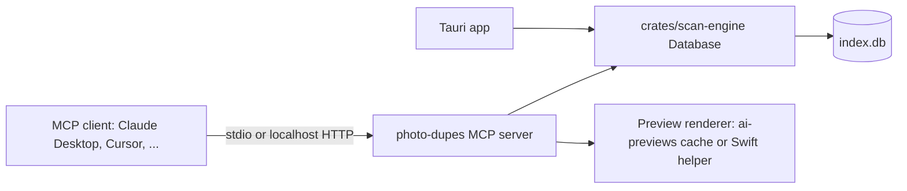

# MCP server and culling skill (deferred draft)

Status: to be considered later. Nothing here is on the roadmap of [AI-assisted keeper selection](ai-assisted-culling.md). This draft records the reasoning so far and the questions to settle before committing to it.

## 1. What this is for

The in-app tiers (rules, Apple Vision, fast judge, expert judge) are the bulk engine: they process thousands of groups cheaply, with a cost estimate, a budget cap and a cache. An MCP server and a skill would add something different: a conversational agent (Claude Desktop, Cursor, ChatGPT desktop or similar) that can look at the app's groups, zoom in, take instructions in plain language, and leave suggestions for you to confirm in the app.

The intended split:

- **In-app tiers**: every group, every scan, batch-priced and cached.
- **Agent through MCP**: the *Needs you* bucket, a handful of special groups, and requests the tiers can't express ("keep every frame where the tower is lit").

## 2. Why MCP is not the bulk engine

- **Speed.** Each group needs several tool round-trips plus a model turn. Hundreds of groups means hours of chat, against minutes (or one batch job) in the app.
- **Context fills up.** Three 1024 px previews and three subject crops are about 3,400 image tokens per group, plus tool output and the model's replies. A 200,000-token context holds roughly 50 groups before the client has to compact or start over, and compaction loses earlier decisions.
- **No batching, and history is re-read every turn.** Chat clients call models at immediate prices, and each turn re-sends the conversation. Rough illustration with `claude-sonnet-5-5`: if a group takes three tool turns and the conversation averages 100,000 tokens, re-reading the history costs about $0.03 per group even when every prefix is cached ($0.10 per million), and about $0.60 when the cache misses. The in-app Tier 3 batch request for the same group costs about $0.006. For the 1,300-group example trip that is roughly $40 or more, against $7.62 for Tier 3 only on `claude-sonnet-5-5` in the app.
- **Less control.** The app can't shuffle order and re-check, enforce its structured output, apply preset thresholds, or cache by content hash when the reasoning happens in someone else's client.
- **Invisible spend.** The estimator, budget cap and usage ledger can't see what an external client spends. On a chat subscription the cost is hidden in usage limits, which image-heavy turns use up quickly.

## 3. Where an agent loop does help

- **Zooming before deciding.** The in-app judges get one fixed subject crop per photo. An agent can ask for a 1:1 crop of the eyes, a sign, or the building's edge, then decide.
- **Consistency across groups within a conversation.** "I prefer the frame where the kids look at the camera" applied to the next twenty groups, without any persistent learning (consistent with the main plan's no-calibration decision).
- **Plain-language rules.** "For the ceremony folder keep every variant", "drop frames where someone walks through the shot". The agent turns these into suggestions per group.
- **Explanations on demand.** "Why B over C?" answered with a zoomed crop.
- **Working through *Needs you* together**, one group at a time, with you in the loop.

## 4. Architecture options



| Option | How | Pros | Cons |
| --- | --- | --- | --- |
| A. Embedded in the app | Streamable HTTP on `127.0.0.1`, random port, bearer token; Settings shows a "Copy client config" button | Shares the app's state; the Review page updates live when the agent leaves a suggestion | The app must be running; a network listener, even on localhost, needs a token and origin checks |
| B. Bundled stdio binary | A small `photo-dupes-mcp` binary shipped inside the app bundle; the client launches it; it opens the same `index.db` | No listener at all; works while the app is closed; the standard setup for desktop MCP clients | Two processes write SQLite (WAL is already on in `schema.sql`; both need a busy timeout and short transactions); the UI has to notice external changes; the binary must refuse to run against a schema version newer than it knows |

Either way the server reuses `scan-engine`'s `Database` (which opens `index.db` from the app data directory) and the rules and protection code from `crates/ai-culling`, so the agent sees the same groups, flags and protection as the UI.

Tentative preference: B first, because there's no listener and it works with the app closed. Revisit if live UI updates matter more.

## 5. Tool surface (sketch)

Group IDs change on every scan (`clear_groups_for_session`), so tools also return and accept the content-based `group_key` from the main plan's cache design.

| Tool | Input | Returns |
| --- | --- | --- |
| `list_sessions` | none | Session id, name, status, group counts per bucket |
| `list_groups` | `session_id`, optional `bucket` and `kind`, `limit`, `cursor` | Group id, `group_key`, kind, member count, bucket, AI leaning, reclaimable bytes |
| `get_group` | `group_id` or `group_key` | Members labeled A, B, C… with content hash, dimensions, capture time offset, camera settings, Tier 1 flags, cached verdict and reason, protection flags. No absolute paths by default |
| `get_preview` | `content_hash`, `long_edge` (512, 1024 or 2048), optional normalized crop `{x, y, w, h}` | A JPEG image with EXIF stripped. This is the zoom tool |
| `set_suggestion` | `group_key`, `keepers` (content hashes), optional `subgroups`, `reason` | The resulting bucket, or a validation error |
| `clear_suggestion` | `group_key` | Confirmation |

Optional extras:

- Resource `rubric://current`: the same rubric text the in-app judges use (appendix A of the main plan).
- Prompt `review_needs_you`: a canned starting prompt that walks the *Needs you* bucket.

Deliberately absent: delete, trash, move, rename, keeper-and-trash, arbitrary file reads, and anything that takes a file path. Scanning and starting a paid AI review are also absent for now (open question below).

`set_suggestion` validates on the server, not in the prompt:

- Protected photos can't be left out of the keepers.
- Every sub-group keeps at least one photo.
- Every hash must belong to the group.

Suggestions are stored with source "agent" and the client's name, shown in the Review page with an "Agent" badge, and pre-select keepers exactly like AI verdicts. You still press `⌘S`, and moving files to Trash stays a separate confirmation in the app.

Storage sketch, kept apart from the verdict cache because a suggestion is a one-off instruction rather than a reusable result:

```sql
CREATE TABLE IF NOT EXISTS agent_suggestions (
    group_key TEXT PRIMARY KEY,
    keepers_json TEXT NOT NULL,     -- content hashes
    subgroups_json TEXT,
    reason TEXT NOT NULL,
    client TEXT NOT NULL,           -- e.g. "Claude Desktop"
    created_at TEXT NOT NULL
);
```

## 6. Safety and privacy

- **Nothing destructive.** The worst a confused or prompt-injected agent can do is leave a bad suggestion, which you see before confirming. Text inside photos (signs, screenshots) can carry instructions, which is one more reason the tools stay non-destructive.
- **Protection is enforced by the server**, the same rules as the in-app pipeline.
- **File access by content hash only**, limited to files in scanned session roots. No path parameters.
- **Option A only:** localhost binding, a random token, and rejection of browser origins.
- **Audit and revert.** Every `set_suggestion` is logged (time, client, reason). The Review page offers "Revert agent suggestions" per session.
- **The model is the client's choice.** Whatever the agent sees goes to whichever model the MCP client uses, under that client's data terms. The app can't control this and should say so on the settings page. Previews are EXIF-stripped and file names are hidden by default.

## 7. Culling skill

A skill gives an agent the workflow and the rubric without you having to explain them in each conversation. Draft in the Agent Skills format:

```markdown
---
name: photo-culling
description: Review duplicate photo groups from Photo Duplicate Finder and suggest keepers. Use when the user asks to go through duplicates, the "Needs you" bucket, or a specific group.
---

# Photo culling

1. Call `list_groups` with bucket "needs_you" unless the user names other groups.
2. For each group, call `get_group`, then `get_preview` at 512 px for every member.
3. Before judging focus or eyes, call `get_preview` with a crop on the subject at 1:1.
4. Apply the rubric in `rubric.md`. Treat intentional variants (different focal length,
   aperture, framing or focus target) as keep-all.
5. Call `set_suggestion` with the keepers and a reason under 25 words. Never leave a
   sub-group without a keeper. When unsure, skip the group and say why.
6. Summarize what you suggested and what you skipped. Never ask the app to delete anything.
```

- `rubric.md` sits next to `SKILL.md` and is the same file the in-app judges load from `crates/ai-culling`'s `rubric` module (copied at build time, or checked by a test), so there's one source of truth.
- A skill without the MCP server isn't useful here: the agent would have to read the database or files directly, bypassing protection.

## 8. Dependencies on the main plan

- Phase 1: buckets, `group_key`, protection rules, `ai-previews/` derivatives.
- Phase 2: the versioned rubric file and the verdict cache (so `get_group` can show the in-app verdict).
- New for this: the server binary or embedded server, `agent_suggestions`, the "Agent" badge, and revert.

## 9. Open questions

- Which clients matter most: Claude Desktop, Cursor, ChatGPT desktop, others?
- Embedded HTTP server, stdio binary, or both?
- One-click setup for non-technical users: a button that writes the client's config, a packaged bundle for clients that support one, or copy-paste instructions?
- Should the agent be able to start a scan or a paid AI review? If yes, it must go through the same estimate and budget cap, with your approval in the app.
- Should file and folder names be exposed? "Wedding/Ceremony" is useful context but it's also personal data.
- Should agent suggestions be able to land in *Ready to confirm*, or always stay in a separate *Agent suggested* view?
- Should plain-language rules be saved for reuse? That is a form of learning, which the main plan deliberately leaves out.
- Where should the skill live: in this repo, bundled with the app, or published to a skills or plugin registry?
- Would an in-app chat panel be the better product? The app would run the same tool loop itself using the API key you already added, with no external client to configure. That fits the "as easy as adding a token" goal better than MCP, at the cost of building a chat UI.
